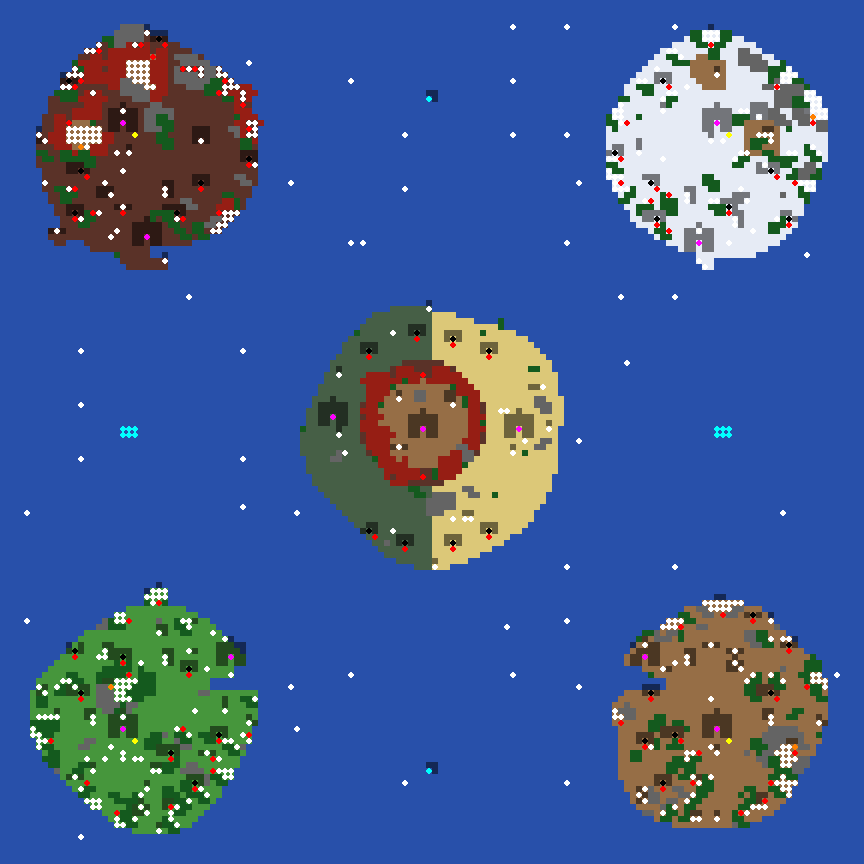

# Four Islands: a custom map for Heroes of Might and Magic II

*Four Islands* is an XL (144×144) map for the original **Heroes of Might and Magic II: The Price of Loyalty** (Gold Edition, as sold by Ubisoft and GOG).

> Six free countries prospered in the Blue Sea, until dragons seized the central island. Upgrade your village, take the port, build a shipyard and sail to the centre: conquer it, or the dragons will crush you.

## What's on the map

- **Four home islands**, one in each corner: Warlock (lava, NW), Knight (snow, NE), Sorceress (grass, SW) and Wizard (dirt, SE). You start in a village and have to grow it into a castle.
- **Seven mines per island**, but each island lacks one rare resource. Trade for it, or fight for it in the centre.
- **No land route between islands.** Take your island's port town, build a shipyard and cross the sea. Two whirlpools link the west and east seas.
- **A prison with a super-hero** on every island: no army, but four Expert secondary skills.
- **The central island** holds the missing rare-resource mines, two computer-held castles (Barbarian and Necromancer) and **Dragonhold**: a castle guarded by 100 Black Dragons, behind a ring of volcanoes whose two gates are held by dragons.
- **Dragon raids**: every week the dragons burn part of your stores until someone takes the centre.
- Rumours in the taverns, a story event on day 1 and treasure in the sea.

Players: Blue (Knight), Green (Sorceress), Red (Warlock) and Yellow (Wizard) can be human or computer. Orange (Barbarian) and Purple (Necromancer) are computer only.

## How to install

1. Download **[FOURISL.MX2](FOURISL.MX2)**: open the file on GitHub and click the **Download raw file** button.
2. Copy it into the `MAPS` folder of your game:
   - **Ubisoft Connect:** `C:\Program Files (x86)\Ubisoft\Ubisoft Game Launcher\games\Heroes of Might and Magic 2\MAPS`
   - **GOG:** `C:\GOG Games\Heroes of Might and Magic 2\MAPS` (or wherever you installed the game)
3. Start the game and choose **New Game → Standard Game** (Price of Loyalty), then pick the map size **Extra Large** or **All**. Choose **Four Islands** from the list.

The map uses the `.MX2` format, so it needs the Price of Loyalty expansion. Every edition sold today includes it. It also loads in [fheroes2](https://github.com/ihhub/fheroes2).

### Как установить (по-русски)

Скачайте [FOURISL.MX2](FOURISL.MX2) и положите в папку `MAPS` игры (для Ubisoft: `C:\Program Files (x86)\Ubisoft\Ubisoft Game Launcher\games\Heroes of Might and Magic 2\MAPS`). В игре: **New Game → Standard Game**, размер карты **Extra Large**, карта **Four Islands**.

## How the map was made

The first version was generated by a Python script that writes the original editor's file format (`tools/build_map.py`). It was then finished by hand in the original map editor. The file in this repository is the hand-finished map, so rerunning the generator would overwrite those changes.

- [docs/plan-ru.md](docs/plan-ru.md): the original design plan (in Russian).
- [docs/map-guide.md](docs/map-guide.md) and [docs/objects.md](docs/objects.md): what the generator placed. The hand-finished map differs in places.
- [docs/generator.md](docs/generator.md): how to run the generator.
- [docs/mx2-format.md](docs/mx2-format.md): notes on the MP2/MX2 file format.

Sources: [homm2-decomp](https://github.com/sushi-shi/homm2-decomp) (CC0) for the file format and object catalogue. The terrain transition logic was ported from the fheroes2 editor (GPL-2.0).
